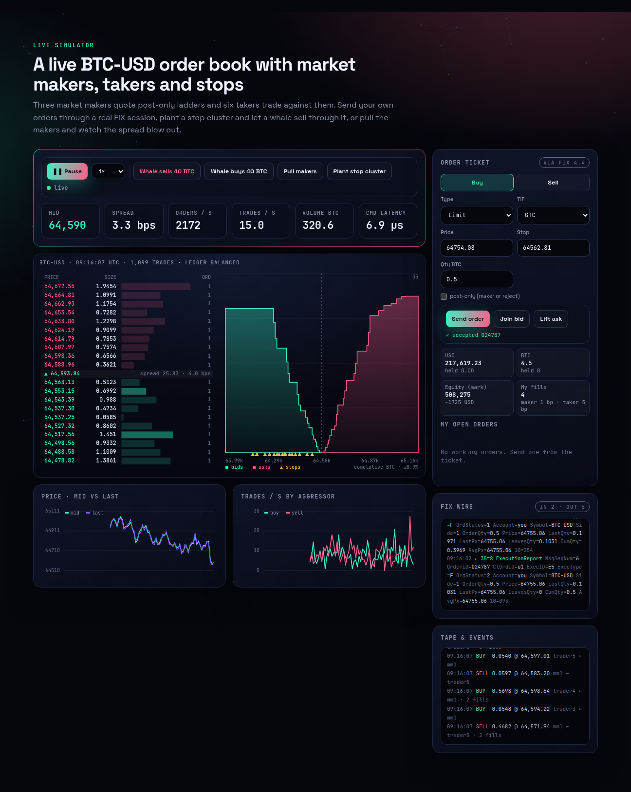
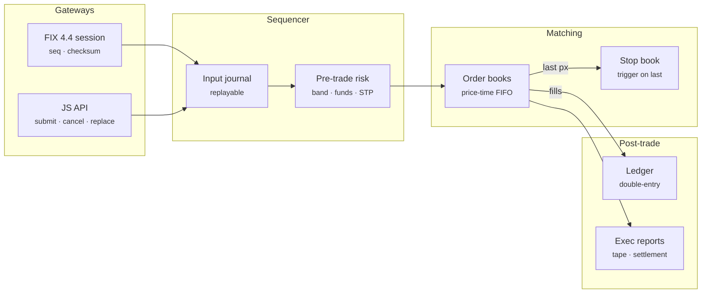
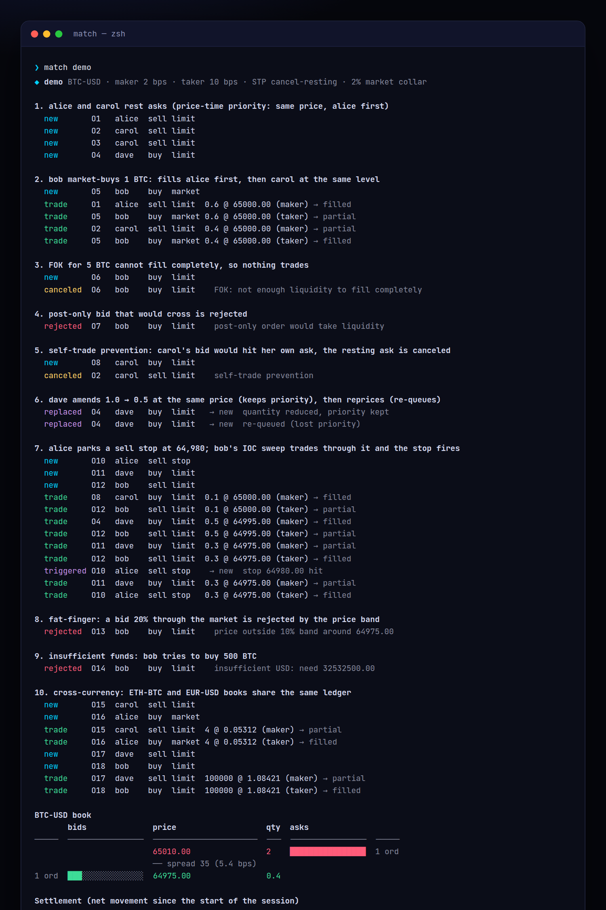
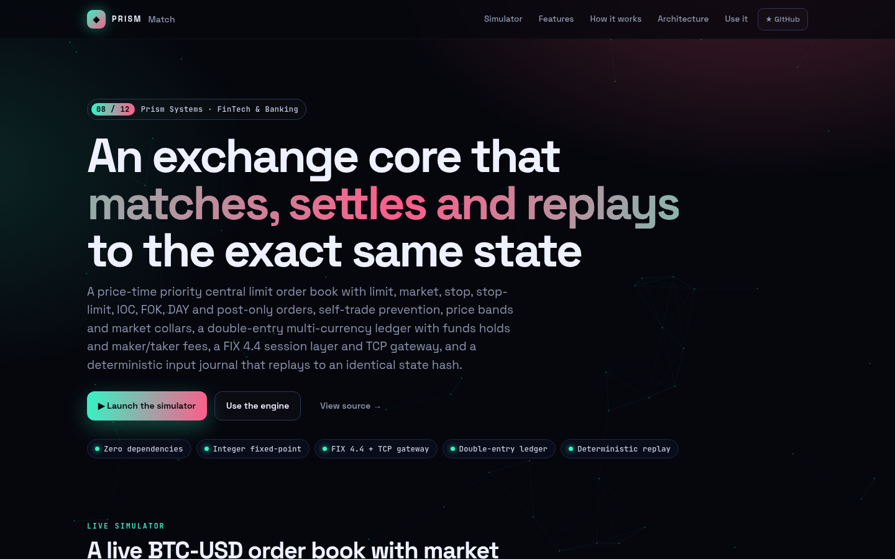
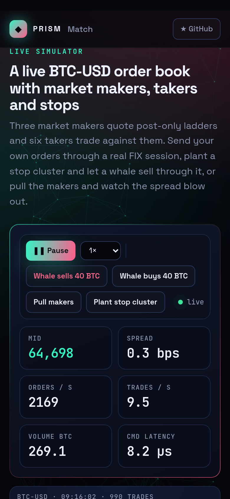

<!-- Prism Systems 08/12 -->
<p align="center">
  
</p>

<p align="center">
  
</p>

<p align="center">
  <a href="https://github.com/krishyaa06/prism-matching-engine/actions/workflows/ci.yml"></a>
  <a href="https://krishyaa06.github.io/prism-matching-engine/"></a>
  
  
  
  <a href="LICENSE"></a>
</p>

<p align="center">
  <a href="https://krishyaa06.github.io/prism-matching-engine/"><b>Live simulator</b></a> ·
  <a href="docs/ARCHITECTURE.md"><b>Architecture</b></a> ·
  <a href="docs/USAGE.md"><b>Docs</b></a> ·
  <a href="#-quick-start"><b>Quick start</b></a>
</p>

<p align="center">
  <a href="https://krishyaa06.github.io/prism-matching-engine/"></a>
</p>


## ⚡ Overview

Every exchange, from a crypto venue to a stock exchange, has the same core: a sequencer that orders commands, a matching engine that applies price-time priority, risk checks that stop bad orders before they trade, and a ledger that moves money exactly once per fill. Prism Matching Engine implements that core in a few hundred lines of dependency-free JavaScript, with the details that usually get skipped: integer arithmetic, funds holds, self-trade prevention, collars, stop cascades, FIX sequence handling and deterministic replay.

## ✨ Features

| | Feature | Details |
| :-: | --- | --- |
| ⇅ | **Price-time priority** | Price levels are kept sorted best-first with binary search, each level is a FIFO queue, and cancels are O(1) through lazy deletion with periodic compaction. |
| ◧ | **Every order type** | Limit, market (converted to IOC with a 2% collar), stop and stop-limit, with GTC, IOC, FOK (pre-checked for full liquidity) and DAY, plus post-only that rejects instead of taking. |
| ⛨ | **Pre-trade risk** | Tick and lot checks, a fat-finger price band around the last price, max order size, funds holds at the worst possible price, and self-trade prevention (cancel-resting or cancel-taker). |
| ⚖ | **Double-entry ledger** | Each fill posts balanced legs for base, quote and maker/taker fees. Balances split into available and held, and `verify()` proves every currency sums to zero. |
| ⌁ | **FIX 4.4** | Encoder and parser with BodyLength and CheckSum, a session with Logon, sequence-gap ResendRequest, session Reject, and D/F/G mapped to ExecutionReport and OrderCancelReject. |
| ↺ | **Cancel / replace** | Reducing quantity keeps queue priority, changing price or increasing size re-queues at the back, and a replace that crosses matches immediately. |
| ⚡ | **Stops that cascade** | Stops trigger on the last trade price and fire as market or limit orders, which can move the price and trigger the next stop in the same command. |
| # | **Deterministic replay** | Commands are journaled before execution. Replaying the journal into a fresh engine reproduces the same SHA-256 hash over books, stops, balances and sequence numbers. |

## 🏗️ Architecture



### How it works

1. **Validate** — Symbol, side, type and TIF are checked, then tick, lot, price band and max size. A market order gets a collar price so it can never sweep the whole book.
2. **Hold funds** — Buyers hold quote at the worst price plus the max fee, sellers hold base. Orders without funds are rejected before touching the book.
3. **Match** — The order walks the opposite side best price first and FIFO within a level, applying self-trade prevention. FOK checks available quantity first.
4. **Settle** — Each fill posts a balanced journal entry: base and quote move between accounts, fees go to the fee account, unused holds are released.
5. **Rest or finish** — Leftover GTC/DAY quantity rests in the book, IOC remainders cancel, then stops are checked against the new last price.

More detail in [docs/ARCHITECTURE.md](docs/ARCHITECTURE.md).

## 🚀 Quick Start

**Try it in the browser:** [https://krishyaa06.github.io/prism-matching-engine/](https://krishyaa06.github.io/prism-matching-engine/), no install needed.

```bash
# CLI, no install
npx github:krishyaa06/prism-matching-engine --help

# add the engine to a project
npm install github:krishyaa06/prism-matching-engine
```

### JavaScript API

```js
import { Engine, FixSession, FixClient, toUnits } from "prism-matching-engine";

const ex = new Engine({ fees: { maker: 2, taker: 10 }, stp: "cancel-resting" });   // bps
ex.ledger.deposit("alice", "BTC", BigInt(toUnits("2")));
ex.ledger.deposit("bob", "USD", BigInt(toUnits("200000")));

ex.submit({ account: "alice", symbol: "BTC-USD", side: "sell", px: "65000.50", qty: "1.2" });
const r = ex.submit({ account: "bob", symbol: "BTC-USD", side: "buy", type: "market", qty: "0.5" });
r.trades;    // [{ id: "T1", px: 6500050000000, qty: 50000000, buyer: "bob", seller: "alice", ... }]
r.reports;   // execution reports: new / trade / canceled / rejected / replaced / triggered

ex.submit({ account: "alice", symbol: "BTC-USD", side: "sell", type: "stop", stopPx: "64980", qty: "0.3" });
ex.replace("O1", { qty: "1.0" });          // smaller qty keeps queue priority
ex.book("BTC-USD").depth(5);               // { bids: [{ px, qty, orders }], asks: [...] }
ex.ledger.verify();                        // { ok: true } — every currency sums to zero

const again = Engine.replay(ex.input, {}, seedDeposits);
again.stateHash() === ex.stateHash();      // true

const fix = new FixSession(ex), cl = new FixClient();
fix.handle(cl.logon());
fix.handle(cl.order({ clOrdId: "a1", account: "bob", symbol: "BTC-USD", side: "buy", px: "65000.50", qty: "0.1", tif: "IOC" }));
```

| Export | What it does |
|---|---|
| `new Engine({ symbols, fees: { maker, taker }, band, collar, stp, maxQty, retain })` | Exchange core. `stp` is `cancel-resting`, `cancel-taker` or `none`; fees in bps |
| `.submit({ account, symbol, side, type, px, stopPx, qty, tif, postOnly, clOrdId })` | `{ order, reports, trades }`. Types `limit` `market` `stop` `stop-limit`, TIF `GTC` `IOC` `FOK` `DAY` |
| `.cancel(id)` · `.replace(id, { px, qty, clOrdId })` · `.endOfDay()` | Order lifecycle (ids or ClOrdIDs) |
| `.book(sym)` → `bbo()` · `mid()` · `depth(n)` · `stops` · `last` | Order book views |
| `.ledger` → `deposit` · `get(acct, ccy)` · `verify()` · `journal` | Double-entry balances (`avail`, `held`, `total` as BigInt units) |
| `.on(fn)` | Events `trade`, `report`, `book` |
| `.input` · `Engine.replay(input, opts, setup)` · `.stateHash()` · `.settlement()` | Journal, replay, state hash, net settlement |
| `encode` · `parse` · `describe` · `pretty` · `TAGS` · `newOrderSingle` · `execReport` | FIX 4.4 messages |
| `new FixSession(engine, { sender, target })` · `.handle(raw)` · `new FixClient()` | FIX session layer |
| `createFixGateway(engine)` from `src/node/fix-gateway.js` | TCP gateway (`net.Server`) |
| `toUnits` · `fmt` · `notional` · `fee` | Integer 1e-8 fixed-point helpers |
| `new Market(engine, { symbol, fair, vol, seed })` · `.step(dt)` · `.whale(side, qty)` | Agent-based market for demos and benchmarks |

### CLI

```bash
$ npx github:krishyaa06/prism-matching-engine demo
$ npx github:krishyaa06/prism-matching-engine book --secs 30
$ npx github:krishyaa06/prism-matching-engine fix examples/orders.fix
$ npx github:krishyaa06/prism-matching-engine bench --orders 300000
$ npx github:krishyaa06/prism-matching-engine replay
$ npx github:krishyaa06/prism-matching-engine serve --port 9878
```

<p align="center"></p>

| Command | Description |
|---|---|
| `match demo` | Scripted session: priority, partials, collar, IOC/FOK/post-only, STP, replace, stops, band, settlement |
| `match book [--symbol BTC-USD --secs 30]` | Run the agent market and print the L2 ladder and tape |
| `match fix [examples/orders.fix]` | Feed FIX messages through a session and print the replies |
| `match bench [--orders 300000]` | Throughput and per-command latency percentiles with the ledger on |
| `match replay [--secs 20]` | Record a session, replay the journal, compare state hashes |
| `match serve [--port 9878]` | FIX 4.4 TCP gateway for BTC-USD, ETH-USD, ETH-BTC, EUR-USD |

## 📸 Screenshots

<table>
  <tr>
    <td width="68%"></td>
    <td width="32%"></td>
  </tr>
</table>

## 🧠 Design Decisions

- **Integers only.** Prices and quantities are integer 1e-8 units and notional uses BigInt, so `0.1 + 0.2` never shows up in a balance.
- **Single-threaded and deterministic.** One sequencer applies commands in order, which is how LMAX, Nasdaq and most crypto venues get both speed and reproducibility. The journal is the source of truth: replay it and you get the same state hash.
- **Hold before you match.** Funds are reserved at the worst price the order could trade at (the limit, or the collar for market and stop orders) plus the maximum fee, so a fill can never overdraw an account.
- **Lazy deletion.** A cancel marks the order dead and fixes the level total. The queue skips dead entries when it next reaches them and compacts itself, so cancels stay O(1).
- **Markets are collared.** A market order becomes an IOC limit 2% through the touch, so an empty book cannot turn a fat finger into a 50% fill.
- **FIX at the edge.** The engine speaks plain objects; the FIX session translates and owns sequence numbers, so other gateways (REST, WebSocket) can be added without touching matching.

## 🏭 Production Notes

The matching, risk and settlement paths are complete and tested. A production venue also needs:

- A persistent, replicated journal (Raft or a primary with hot standbys replaying the same input) and periodic snapshots so recovery does not replay from genesis.
- Market data feeds (incremental L2/L3 over multicast or WebSocket with sequence numbers and snapshots) and a drop-copy feed.
- FIX resend from a persisted message store, session schedules, and certification tests with real counterparties.
- Kill switches, per-account position and credit limits, circuit breakers / auctions after large moves, and audit trails for regulators.
- A faster runtime for the hot path if needed: this engine does roughly 70k commands per second with the full ledger in plain JavaScript; Rust, C++ or Java with preallocated memory reach millions.

## 📁 Project Structure

```text
prism-matching-engine/
├── assets/
│   └── logo.svg
├── bin/
│   └── match.js
├── css/
│   └── app.css
├── docs/
│   ├── ARCHITECTURE.md
│   └── USAGE.md
├── examples/
│   └── orders.fix
├── js/
│   └── app.js
├── src/
│   ├── lib/
│   │   ├── cli.js
│   │   ├── rng.js
│   │   └── sha256.js
│   ├── node/
│   │   └── fix-gateway.js
│   ├── book.js
│   ├── decimal.js
│   ├── engine.js
│   ├── fix.js
│   ├── index.js
│   ├── ledger.js
│   └── sim.js
├── test/
│   └── engine.test.js
├── .gitignore
├── LICENSE
├── README.md
├── index.html
└── package.json
```

## 🧪 Tests

```bash
npm test
```

The test suite uses the built-in `node:test` runner, so there is nothing to install. CI runs it on Node 20 and 22.

## 🗺️ Roadmap

- [ ] Snapshots + journal compaction
- [ ] L2/L3 market data feed with sequence numbers
- [ ] Opening / closing auctions
- [ ] Iceberg and pegged orders

## 🤝 Contributing

1. Fork the repo and create a branch: `git checkout -b feat/my-idea`
2. Make your change in `src/` and add a test in `test/`
3. Run `npm test`, then open a Pull Request

## 🔷 Part of Prism Systems

**Prism Matching Engine** is system **08 of 12** in **Prism Systems**, a series of open-source reference implementations of large-scale infrastructure by [Prism Protocol](https://dc.gg/prismprotocol). Each one ships a real engine, a CLI and a live simulator, all with zero dependencies.

## 👤 Author

<table>
  <tr>
    <td align="center">
      <a href="https://github.com/krishyaa06"><br><b>Soumya Bhandare</b></a><br>
      <sub>Founder @ Prism Protocol</sub>
    </td>
    <td>
      <a href="https://dc.gg/prismprotocol"></a><br>
      <a href="https://instagram.com/prism_protocol_"></a><br>
      <a href="https://x.com/krishyaa06"></a>
    </td>
  </tr>
</table>

## 📄 License

Released under the [MIT License](LICENSE).

<p align="center">
  <b>If this helped you learn something, consider giving it a ⭐</b><br>
  <sub>"Build. Create. Compete." · Made with ⚡ by Prism Protocol</sub>
</p>


