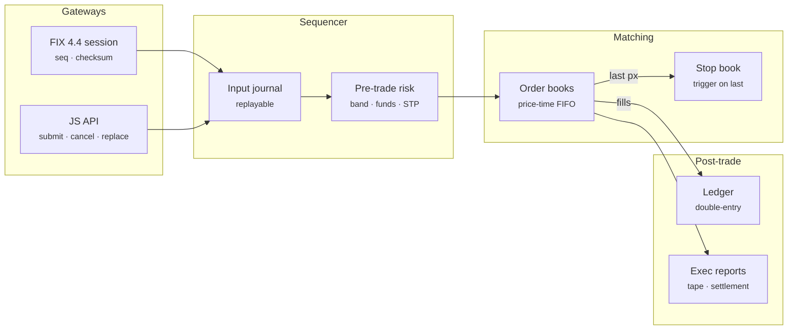

# Prism Matching Engine — Architecture

Every exchange, from a crypto venue to a stock exchange, has the same core: a sequencer that orders commands, a matching engine that applies price-time priority, risk checks that stop bad orders before they trade, and a ledger that moves money exactly once per fill. Prism Matching Engine implements that core in a few hundred lines of dependency-free JavaScript, with the details that usually get skipped: integer arithmetic, funds holds, self-trade prevention, collars, stop cascades, FIX sequence handling and deterministic replay.

## System diagram

## How it works

1. **Validate** — Symbol, side, type and TIF are checked, then tick, lot, price band and max size. A market order gets a collar price so it can never sweep the whole book.
2. **Hold funds** — Buyers hold quote at the worst price plus the max fee, sellers hold base. Orders without funds are rejected before touching the book.
3. **Match** — The order walks the opposite side best price first and FIFO within a level, applying self-trade prevention. FOK checks available quantity first.
4. **Settle** — Each fill posts a balanced journal entry: base and quote move between accounts, fees go to the fee account, unused holds are released.
5. **Rest or finish** — Leftover GTC/DAY quantity rests in the book, IOC remainders cancel, then stops are checked against the new last price.

## Design decisions

- **Integers only.** Prices and quantities are integer 1e-8 units and notional uses BigInt, so `0.1 + 0.2` never shows up in a balance.
- **Single-threaded and deterministic.** One sequencer applies commands in order, which is how LMAX, Nasdaq and most crypto venues get both speed and reproducibility. The journal is the source of truth: replay it and you get the same state hash.
- **Hold before you match.** Funds are reserved at the worst price the order could trade at (the limit, or the collar for market and stop orders) plus the maximum fee, so a fill can never overdraw an account.
- **Lazy deletion.** A cancel marks the order dead and fixes the level total. The queue skips dead entries when it next reaches them and compacts itself, so cancels stay O(1).
- **Markets are collared.** A market order becomes an IOC limit 2% through the touch, so an empty book cannot turn a fat finger into a 50% fill.
- **FIX at the edge.** The engine speaks plain objects; the FIX session translates and owns sequence numbers, so other gateways (REST, WebSocket) can be added without touching matching.

## Production notes

The matching, risk and settlement paths are complete and tested. A production venue also needs:

- A persistent, replicated journal (Raft or a primary with hot standbys replaying the same input) and periodic snapshots so recovery does not replay from genesis.
- Market data feeds (incremental L2/L3 over multicast or WebSocket with sequence numbers and snapshots) and a drop-copy feed.
- FIX resend from a persisted message store, session schedules, and certification tests with real counterparties.
- Kill switches, per-account position and credit limits, circuit breakers / auctions after large moves, and audit trails for regulators.
- A faster runtime for the hot path if needed: this engine does roughly 70k commands per second with the full ledger in plain JavaScript; Rust, C++ or Java with preallocated memory reach millions.
